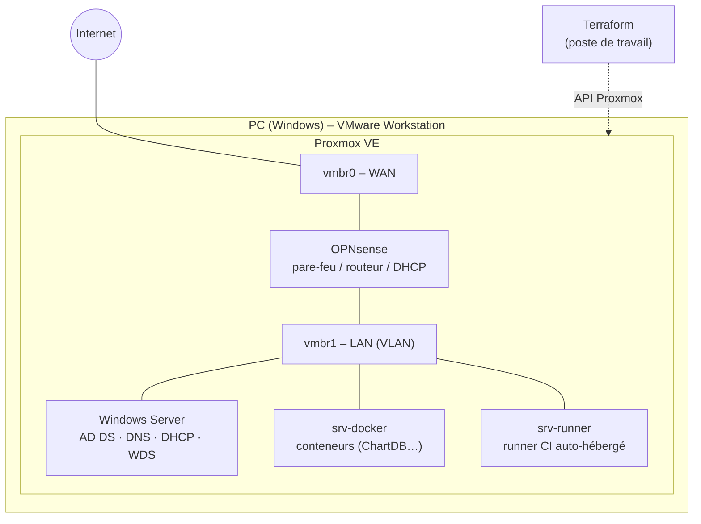

# Homelab : infrastructure virtualisée et automatisée

Mon laboratoire personnel pour pratiquer l'administration système, le réseau et les outils DevOps sur une vraie infrastructure : virtualisation, pare-feu, segmentation réseau, annuaire Windows, Infrastructure as Code et intégration continue.

## Architecture



| Brique | Rôle |
|---|---|
| **Proxmox VE** | Hyperviseur : VM, bridges réseau, templates cloud-init |
| **OPNsense** | Pare-feu et routeur entre le WAN et le LAN, segmentation en VLAN, accès SSH filtré |
| **Windows Server** | Active Directory, DNS, DHCP, déploiement de postes par PXE (WDS) |
| **Terraform** | Création reproductible des VM Linux par l'API Proxmox |
| **Docker** | Services auto-hébergés (ex. ChartDB) |
| **Runner CI** | Exécution de pipelines GitHub Actions / GitLab CI dans le lab |

## Infrastructure as Code

Le dossier [`terraform/`](terraform) crée les VM Linux du lab à partir d'un template cloud-init, avec le provider [`bpg/proxmox`](https://registry.terraform.io/providers/bpg/proxmox/latest).

- Un **module réutilisable** [`modules/proxmox-vm`](terraform/modules/proxmox-vm) décrit une VM : CPU, RAM, disque, bridge, VLAN, IP et clé SSH.
- La liste des VM est une simple variable `vms` : ajouter une machine revient à ajouter une entrée.
- Le jeton d'API Proxmox est lu depuis `terraform.tfvars`, qui n'est **jamais versionné**.

```bash
cd terraform
cp terraform.tfvars.example terraform.tfvars   # renseignez l'URL de l'API, le jeton et votre clé SSH
terraform init
terraform plan
terraform apply
```

Prérequis côté Proxmox : un template cloud-init (ID `9000` par défaut) et un utilisateur API dédié à Terraform, avec un jeton aux droits limités.

## Retours d'expérience

Les problèmes que j'ai rencontrés dans le lab et comment je les ai résolus :

- [Réseau en virtualisation imbriquée : VMware → Proxmox → OPNsense](docs/troubleshooting/01-reseau-virtualisation-imbriquee.md) : mode promiscuous, routage IP, filtrage OUI du NAT VMware
- [Jobs GitHub Actions bloqués en « Queued »](docs/troubleshooting/02-runner-github-actions-queued.md) : runner auto-hébergé hors ligne
- [Déployer ChartDB sur un petit serveur](docs/troubleshooting/03-chartdb-docker-memoire.md) : version de Node.js, build Vite tué par manque de mémoire, swap
- [Windows Server : AD, DHCP et PXE](docs/windows-server-ad.md)

## Prochaines étapes

- [ ] Configuration des VM avec Ansible après leur création par Terraform
- [ ] Supervision (Prometheus + Grafana)
- [ ] Pipeline CI qui lance `terraform fmt`, `validate` et `plan` à chaque commit

> Les adresses IP, noms d'hôte et identifiants des exemples sont fictifs.

---
Yvan Seukou · Mastère Ingénierie DevOps à l'ESGI · [Portfolio](https://yvanseukou.netlify.app) · [LinkedIn](https://www.linkedin.com/in/yvanseukou) · [GitHub](https://github.com/YvanSeukou)
